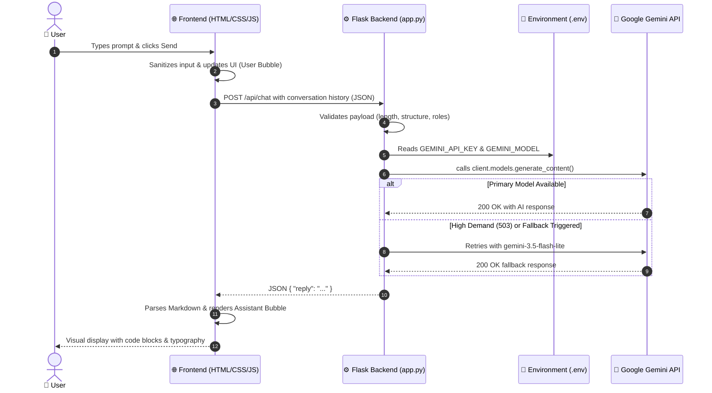

# 🎓 AI Smart Assistant — Complete Project Presentation & Viva Guide

> **Project Name:** AI Smart Assistant  
> **Tech Stack:** Python (Flask), Google Gemini API (`google-genai` SDK), HTML5, CSS3, Vanilla JavaScript  
> **Target Audience:** Evaluators, Professors, Project Guides, and Peers  

---

## 📌 Table of Contents
1. [Project Overview & Elevator Pitch](#1-project-overview--elevator-pitch)
2. [Problem Statement & Motivation](#2-problem-statement--motivation)
3. [System Architecture & Data Flow](#3-system-architecture--data-flow)
4. [Technology Stack & Justification](#4-technology-stack--justification)
5. [Key Features & Capabilities](#5-key-features--capabilities)
6. [Security & Engineering Best Practices](#6-security--engineering-best-practices)
7. [Step-by-Step Live Demonstration Script](#7-step-by-step-live-demonstration-script)
8. [Slide-by-Slide Presentation Structure](#8-slide-by-slide-presentation-structure)
9. [Anticipated Viva / Examiner Questions & Model Answers](#9-anticipated-viva--examinator-questions--model-answers)
10. [Future Scope & Production Enhancements](#10-future-scope--production-enhancements)

---

## 1. Project Overview & Elevator Pitch

### What is AI Smart Assistant?
**AI Smart Assistant** is a full-stack, conversational AI web application designed for interactive learning, software debugging, and general knowledge queries. It bridges human intent with state-of-the-art Large Language Models (LLMs) via the **Google Gemini API** (`gemini-3.5-flash`), wrapped inside an intuitive, responsive, and secure web interface.

### The 30-Second Elevator Pitch (Memorize this for opening):
> *"Good morning respected evaluators. Today I am presenting **AI Smart Assistant**, an AI-powered conversational platform built on Python Flask and Google’s latest Gemini GenAI SDK. Our core objective was to build an enterprise-secure, lightweight, and responsive assistant that eliminates credential exposure in the client, handles multi-turn context cleanly, and formats complex technical responses—such as syntax-highlighted code blocks and structured Markdown—in real time. It is fully functional, easy to deploy locally, and engineered with robust fault tolerance."*

---

## 2. Problem Statement & Motivation

### The Problem
1. **Security Vulnerabilities in Client-Side AI Apps:** Many introductory AI tutorials mistakenly call external LLM APIs directly from client-side JavaScript, exposing private API keys and quotas to malicious users in the browser network tab.
2. **Heavyweight Over-Engineering:** Modern web applications often rely on bulky JavaScript frameworks (like 50MB node_modules bundles) for basic chat interfaces, leading to slow load times and high maintenance overhead.
3. **Lack of Resilient Error Handling:** In public LLM deployments, spikes in demand or model deprecations frequently cause frontend crashes if backend exception handling is inadequate.

### Our Solution
- **Zero Client-Side Secret Leakage:** A secure backend proxy pattern where all requests flow through Flask, keeping credentials isolated on the server.
- **Ultra-Lightweight Vanilla Frontend:** Fast loading with pure HTML5, modern CSS3 (glassmorphic styling, flexbox/grid layout), and vanilla JavaScript.
- **Resilient AI Pipeline:** Automatic model fallback handling, rate limit mitigation, and clean HTTP status signaling (200, 400, 401, 429, 502, 503).

---

## 3. System Architecture & Data Flow

The project follows a **Client-Server Proxy Architecture**:



### Architectural Highlights:
1. **Single Entry Point (`app.py`):** Acts as the controller serving static assets, rendering the single-page application, and hosting REST endpoints.
2. **Stateless Backend Design:** Conversation state is maintained in the client session memory and transmitted per request, allowing effortless scaling without requiring centralized session databases.
3. **Safe System Prompt Injection:** Every API payload is appended with an explicit system prompt instructing the model to be accurate, concise, and technical.

---

## 4. Technology Stack & Justification

| Layer | Component | Choice | Justification |
| :--- | :--- | :--- | :--- |
| **Frontend** | Markup & Structure | **HTML5** | Semantic tags, accessible layout (`<aside>`, `<main>`, `<header>`). |
| | Styling | **CSS3** | Custom design system, CSS variables for theming, glassmorphism, responsive sidebar layout without Tailwind or Bootstrap overhead. |
| | Client Logic | **Vanilla JavaScript (ES6+)** | Zero dependencies, instant execution, native `fetch()` API, custom regex-based Markdown & code formatter. |
| **Backend** | Micro-framework | **Python 3 + Flask** | Lightweight WSGI framework, minimal boilerplate, rapid routing, clean JSON handling. |
| | Config & Secrets | **python-dotenv** | Loads `.env` variables into `os.environ` securely; keeps secrets out of Git. |
| **AI Layer** | SDK | **google-genai** | The official, latest Google GenAI Python SDK supporting modern Gemini models. |
| | Model | **gemini-3.5-flash** | High tokens-per-second throughput, low latency, advanced reasoning, and cost efficiency. |

---

## 5. Key Features & Capabilities

1. **Intelligent Conversational AI:**
   - Powered by Gemini 3.5 Flash.
   - Answers everyday inquiries, coding challenges, mathematical problem solving, and concept breakdowns.
2. **Context-Aware Multi-Turn Dialogues:**
   - Retains conversation flow up to 20 past turns so follow-up queries ("*Can you explain line 3?*") retain full context.
3. **Rich Markdown & Code Rendering:**
   - Converts Markdown headers, bold, italics, inline code, and multi-line syntax blocks with monospace styling.
4. **Dynamic Suggestion Chips:**
   - One-click starter prompts ("*What is an API?*", "*Explain Quantum Computing*", "*Debug my Python loop*") for first-time users.
5. **Multi-Session Management:**
   - "+ New Chat" button allows users to start fresh sessions while saving past chats in the sidebar history.
6. **Real-time Server Health Monitoring:**
   - `/api/health` polls background connectivity and updates status badges in the sidebar footer (`Online · gemini-3.5-flash`).

---

## 6. Security & Engineering Best Practices

### 🛡️ 1. Absolute API Key Isolation
- The Gemini API key is stored exclusively in `.env`.
- Frontend code (`index.html`, `app.js`, `style.css`) contains **zero** references to the API key.
- The `.gitignore` file explicitly lists `.env` to prevent accidental credential commits.

### 🛡️ 2. Input Sanitization & Safety Controls
- **Payload Validation:** Inspects JSON validity, verifies the message array, and checks message roles.
- **Length Throttling:** Caps single messages at 4,000 characters and trims history to 20 turns to prevent token starvation or buffer exploitation.
- **Output Sanitization:** Escapes raw HTML inside user messages to guard against Cross-Site Scripting (XSS).

### 🛡️ 3. Resilient Error & Exception Handling
- Distinct HTTP status codes returned for each failure mode:
  - `400 Bad Request`: Malformed payload or empty input.
  - `401 Unauthorized`: Bad or revoked API credentials.
  - `429 Too Many Requests`: LLM provider rate limit exceeded.
  - `502 / 503 Service Unavailable`: LLM provider outage or demand spike (handled with automatic model fallback).

---

## 7. Step-by-Step Live Demonstration Script

Follow this exact walkthrough during your presentation demo:

### Step 1: Show the Application Running
- Point your browser to `http://127.0.0.1:5000`.
- **What to say:**
  > *"As you can see, our application loads instantly with a clean dark-mode-ready interface. In the bottom left, the live health beacon indicates that our Flask backend is actively connected to the Gemini 3.5 Flash model."*

### Step 2: Test with a Quick Starter Chip
- Click the suggestion chip: **"What is an API?"**
- Watch the AI response generate in 1-2 seconds.
- **What to say:**
  > *"When we click a suggestion, the frontend issues an asynchronous HTTP POST request to our `/api/chat` route. Notice how the response is parsed dynamically with bolded keywords and clean paragraphs."*

### Step 3: Test a Coding Prompt (Demonstrate Technical Capability)
- Type this prompt into the chat box:
  > `"Write a Python function to check if a string is a palindrome, with examples."`
- Press Enter or click the Send button.
- **What to say:**
  > *"Notice how the assistant formats the Python code inside a styled monospace code box with indentation and comments. The frontend custom Markdown renderer handles code fences seamlessly."*

### Step 4: Demonstrate Multi-Turn Context (Conversational Memory)
- Type a follow-up query:
  > `"Can you optimize that to ignore spaces and case sensitivity?"`
- **What to say:**
  > *"Notice that I did not repeat the code. Because the client transmits the conversation history, Gemini understands the context and refactors the exact function from the previous turn."*

### Step 5: Demonstrate New Chat & Session Switching
- Click **"+ New Chat"** in the top left.
- Show that a new blank session starts while the previous conversation is archived under "Recent Chats" in the sidebar.

---

## 8. Slide-by-Slide Presentation Structure

If creating PowerPoint / Google Slides, use this 8-slide outline:

| Slide # | Slide Title | Visual / Key Points on Slide |
| :---: | :--- | :--- |
| **1** | **Title Slide** | Project Name: AI Smart Assistant<br>Subtitle: Full-Stack Generative AI Platform<br>Presented By: [Your Name]<br>Under Guidance Of: [Guide/Professor Name] |
| **2** | **Introduction & Problem Statement** | • Problem: High barriers to deploying secure, responsive AI apps.<br>• Security Risk: Client-side key leakage.<br>• Goal: Build a secure, lightweight, full-stack assistant. |
| **3** | **Architecture & Flow Diagram** | • Show the Mermaid sequence diagram.<br>• Client (Browser) ↔ Server Proxy (Flask) ↔ LLM (Gemini 3.5 Flash). |
| **4** | **Technology Stack** | • Frontend: HTML5, CSS3, ES6 JavaScript.<br>• Backend: Python, Flask, python-dotenv.<br>• AI: Google GenAI Python SDK (`google-genai`). |
| **5** | **Security & Defensive Design** | • Server-side secret containment.<br>• Payload length checks & rate limit mitigation.<br>• XSS prevention and clean HTTP error mapping. |
| **6** | **Live Demonstration** | *(Switch to live browser tab `http://127.0.0.1:5000`)*<br>Demonstrate: starter prompts, coding solution, and multi-turn context. |
| **7** | **Future Enhancements** | • Database integration (PostgreSQL for user accounts).<br>• Streaming text with Server-Sent Events (SSE).<br>• RAG for uploaded documents (PDF/CSV). |
| **8** | **Conclusion & Q&A** | • Summary: Fully functional, responsive, and secure.<br>• "Thank you! Open for questions." |

---

## 9. Anticipated Viva / Examiner Questions & Model Answers

### Q1: Why did you use Flask instead of Django or FastAPI?
**Answer:**
> *"Flask is a lightweight micro-framework that gives us complete architectural control without the overhead of Django's heavy ORM and admin packages, which aren't needed for a stateless AI proxy. FastAPI is also excellent for async operations, but Flask 3.0 provides robust, reliable synchronous WSGI routing with minimal dependencies, making it optimal for academic demonstration and easy local deployment."*

### Q2: Why can’t we call the Google Gemini API directly from JavaScript in the browser?
**Answer:**
> *"Calling the Gemini API directly from frontend JavaScript requires embedding the `API_KEY` in client code or transmitting it over headers readable in the browser's DevTools Network tab. Anyone opening Developer Tools could steal the key, abuse the quota, or incur financial costs. By routing requests through our Flask backend, the key remains securely stored in the server's `.env` file and is never transmitted to the client."*

### Q3: How do you maintain multi-turn chat history if Flask is stateless?
**Answer:**
> *"The frontend maintains an in-memory array of the active conversation: `[ {role: 'user', content: '...'}, {role: 'model', content: '...'} ]`. When a new message is sent, the entire context window (capped to the last 20 messages for safety) is sent to Flask. Flask validates and forwards this array to Gemini. This keeps the backend completely stateless, scalable, and crash-resistant without requiring server-side session stores."*

### Q4: What happens if Google’s API goes down or rate limits you?
**Answer:**
> *"Our backend includes comprehensive exception handling. In `app.py`, we inspect API exceptions. If a 429 rate limit occurs, we return HTTP 429 with a user-friendly message. If a 503 service unavailable or model demand spike occurs, the backend automatically attempts a fallback to `gemini-3.5-flash-lite`. If all attempts fail, the client receives a structured JSON error and displays an in-app retry button rather than crashing the page."*

### Q5: How does your frontend format Markdown without installing external libraries?
**Answer:**
> *"We implemented a lightweight, custom regular-expression parsing engine in `app.js`. It parses triple-backtick code blocks (` ``` `) into monospace syntax blocks, converts markdown headers and bold/italic asterisks into semantic HTML tags, and escapes dangerous HTML characters to prevent XSS attacks."*

---

## 10. Future Scope & Production Enhancements

When evaluators ask: *"How would you take this project to the next level?"*, mention these points:

1. **Streaming Responses (SSE / WebSockets):**
   - Stream tokens as they are generated by Gemini to provide a real-time typing effect.
2. **Persistent Storage & User Authentication:**
   - Integrate SQLite or PostgreSQL with user authentication (OAuth 2.0 / JWT) so chats persist across devices.
3. **Retrieval-Augmented Generation (RAG):**
   - Allow users to upload PDFs, textbooks, or codebases; vectorize them using ChromaDB/FAISS, and ask grounded questions.
4. **Multimodal Capabilities:**
   - Leverage Gemini's vision features to allow users to attach images or screenshots for error diagnosis and diagram explanations.
5. **Containerization & Cloud Deployment:**
   - Package the app using Docker and deploy to Google Cloud Run or AWS ECS for global scalability.

---

### 🏁 Final Presentation Tip:
- Keep the terminal and browser window already open before starting the presentation.
- Test a quick prompt right before you enter the presentation room to warm up the connection.
- Speak confidently about **Architecture** and **Security**—evaluators always appreciate students who understand *why* they built the backend as a secure proxy!
